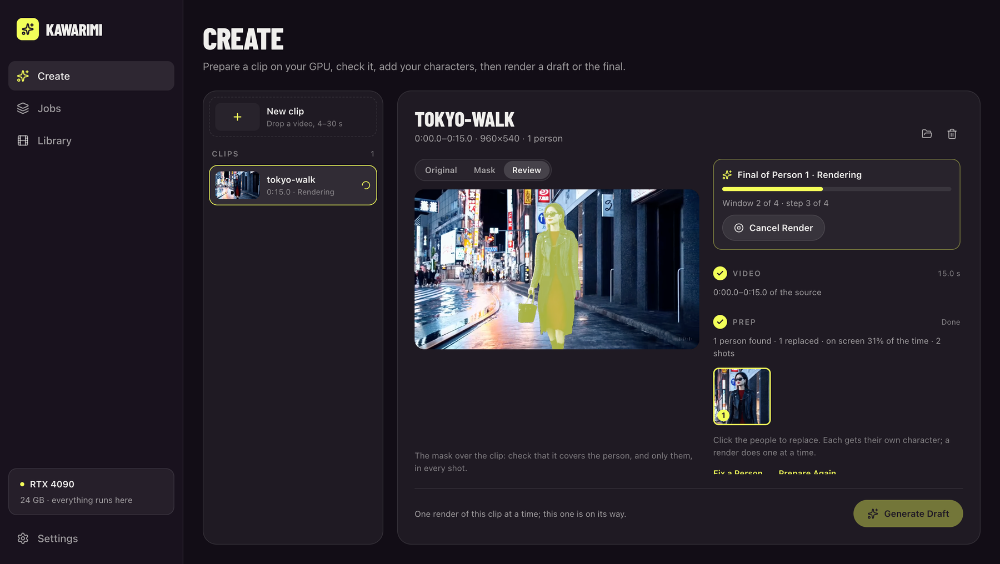
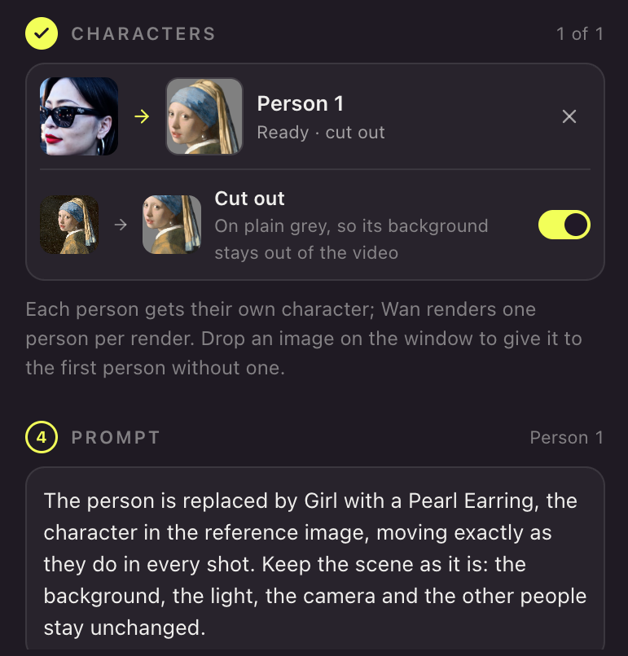
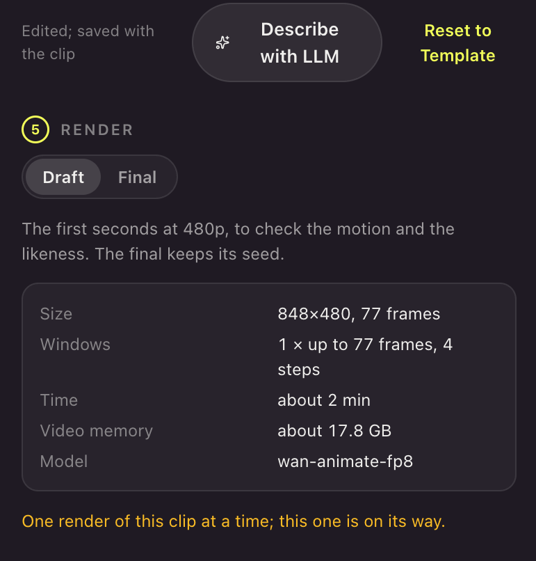
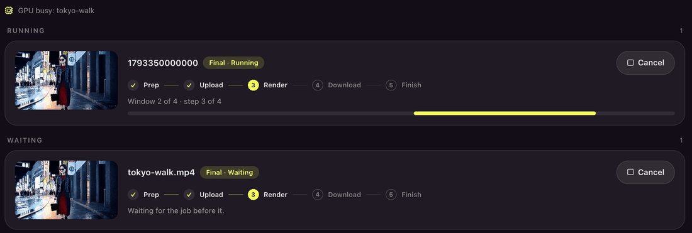
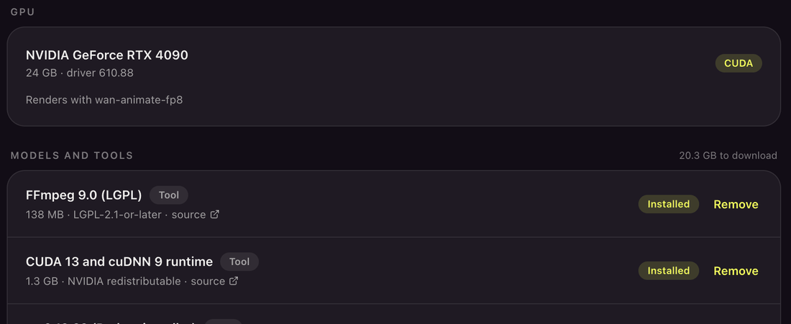

<div align="center">


# Kawarimi

**Local AI character swap for video, on Windows and Linux.**

Replace a person in any clip with a character from one image. The camera, the moves and the timing stay; the person
changes. Prep, prompt and render all run on your own NVIDIA GPU: no account, no cloud, no per-video cost.

[](https://github.com/jutsuhq/kawarimi-local-character-swap/releases)

[Install](#install) · [Quick start](#quick-start) · [How it works](#how-it-works) · [Agents](#agents) ·
[Requirements](#requirements) · [Build](#build-from-source)

[](LICENSE)
[](#requirements)
[](#requirements)

</div>

<br>



<sub>Clip: <i>Tokyo Walk</i>, generated with OpenAI Sora, public domain. Character: Vermeer, <i>Girl with a Pearl Earring</i>.</sub>

Kawarimi (変わり身の術) is the substitution technique. It is the Windows and Linux sibling of
[Swapjutsu](https://github.com/jutsuhq/swapjutsu-seedance-character-swap) for macOS, rebuilt around open models that
run on your own card. Both are made by [Jutsu Studio](https://jutsustudio.com/kawarimi/).

<table>
<tr>
<td width="50%"></td>
<td width="50%"></td>
</tr>
<tr>
<td><b>One image per person.</b> Kawarimi cuts the character off its background and writes the prompt, or a local LLM does.</td>
<td><b>Draft, then final.</b> Size, time and video memory are shown before anything renders.</td>
</tr>
<tr>
<td></td>
<td></td>
</tr>
<tr>
<td><b>A queue that survives restarts.</b> Close the app mid-render; it resumes where it stood.</td>
<td><b>Every download listed.</b> Each model and tool with its size, license and source, pinned and checked by SHA-256.</td>
</tr>
</table>

## Install

Download from [Releases](https://github.com/jutsuhq/kawarimi-local-character-swap/releases):

| System | File | Install |
|---|---|---|
| Windows 10/11 | `Kawarimi_<version>_x64-setup.exe` | Run it |
| Ubuntu, Debian | `Kawarimi_<version>_amd64.deb` | `sudo apt install ./Kawarimi_<version>_amd64.deb` |
| Any Linux | `Kawarimi_<version>_amd64.AppImage` | `chmod +x Kawarimi_<version>_amd64.AppImage` and run it |

The Windows installer is not code-signed yet: SmartScreen asks first (More info › Run anyway). `SHA256SUMS` in each
release lists the files' checksums.

Models are not bundled: they download from Settings when you ask for them, each pinned to an exact revision and
checked against its SHA-256.

## Quick start

1. **Download the tools.** In Settings, download FFmpeg, the CUDA runtime and the prep models, then install ComfyUI
   and the Wan weights for your card.
2. **Prepare a clip.** In Create, drop a 4–30 s video and pick who to replace. Fix a mask with + and − points if
   needed.
3. **Add a character.** Drop one image; Kawarimi cuts it off its background.
4. **Write the prompt**, or let the optional local LLM write it.
5. **Render** a draft, then the final. Results land in Library with the original sound.

## How it works

| | Step | Model |
|---|---|---|
| 1 | Normalise the clip | FFmpeg |
| 2 | Find the cuts | TransNetV2 |
| 3 | Find the people | RT-DETRv2 |
| 4 | Track the person through every shot | EdgeTAM, SAM 2.1 tiny |
| 5 | Match the same person across cuts | appearance |
| 6 | Cut out the character | BiRefNet |
| 7 | Write the prompt (optional) | Qwen3.5-9B on llama.cpp |
| 8 | Render | Wan 2.2 Animate on ComfyUI |
| 9 | Put the original sound back | FFmpeg |

Prep is Rust and ONNX Runtime on CUDA; the tracker is its own crate,
[edgetam-onnx](https://github.com/jutsuhq/edgetam-onnx). Rendering runs on a ComfyUI the app installs and manages, or
on your own ComfyUI elsewhere (Settings › ComfyUI). Details: [PREP](docs/PREP.md), [tracking](https://github.com/jutsuhq/edgetam-onnx),
[RENDER](docs/RENDER.md).

## Agents

`kawarimi-mcp` is an MCP server: Claude Code or any MCP client can prepare clips, cut out characters and queue
renders, within daily limits you set.

```bash
cargo build --release -p kawarimi-mcp
claude mcp add kawarimi -- ./target/release/kawarimi-mcp
```

Tools and limits: [docs/MCP.md](docs/MCP.md).

## Requirements

- Windows 10/11 or Linux, x86_64
- NVIDIA GPU with a current driver (CUDA 13; Linux: driver 580+). 12 GB of VRAM or more recommended for rendering.
- About 22 GB of disk for models and ComfyUI

## Privacy

No account, no telemetry. Nothing downloads until you ask, and nothing you prepare or render leaves the computer.

## Build from source

Needs Rust, Node 24 with pnpm, and on Linux `libwebkit2gtk-4.1-dev libappindicator3-dev librsvg2-dev patchelf`.

```bash
pnpm install
pnpm tauri dev
cargo test --workspace
```

Installers: [docs/RELEASE.md](docs/RELEASE.md).

## Related

Other open-source projects from [Jutsu Studio](https://jutsustudio.com/):

- [Jutsu Studio](https://github.com/jutsuhq/jutsu-studio): the open-source Higgsfield desktop app for Mac · [jutsustudio.com](https://jutsustudio.com/)
- [Swapjutsu](https://github.com/jutsuhq/swapjutsu-seedance-character-swap): free character swap for Mac, no watermark · [jutsustudio.com/swapjutsu](https://jutsustudio.com/swapjutsu/)
- [Content Factory](https://github.com/jutsuhq/content-factory): open-source faceless video generator for Shorts, TikTok and Reels · [jutsustudio.com/content-factory](https://jutsustudio.com/content-factory/)
- [EdgeTAM Core ML](https://github.com/jutsuhq/edgetam-coreml): EdgeTAM video object tracking in Core ML, on the Apple Neural Engine
- [edgetam-onnx](https://github.com/jutsuhq/edgetam-onnx): the same tracker in Rust on ONNX Runtime CUDA, for Windows and Linux
- [Higgsfield Gateway](https://github.com/jutsuhq/higgsfield-gateway): a budget-capped Higgsfield API gateway on Cloudflare Workers · [jutsustudio.com/blog/higgsfield-api-production](https://jutsustudio.com/blog/higgsfield-api-production/)
- [Seedance 2.5 Prompt Skill](https://github.com/jutsuhq/higgsfield-seedance-prompt-skill): a Claude skill that writes Seedance 2.5 prompts for Higgsfield · [jutsustudio.com/blog/seedance-prompt-skill](https://jutsustudio.com/blog/seedance-prompt-skill/)
- [AI video API prices](https://github.com/jutsuhq/video-api-prices): what one second of AI video costs at 30+ providers, updated daily · [jutsustudio.com/video-api-pricing](https://jutsustudio.com/video-api-pricing/)
- [Open Source Higgsfield](https://github.com/jutsuhq/open-source-higgsfield): every #OpenSourceHiggsfield challenge project, by category · [jutsustudio.com/open-source-higgsfield](https://jutsustudio.com/open-source-higgsfield/)
- [awesome-higgsfield](https://github.com/jutsuhq/awesome-higgsfield): tools, SDKs, agent skills and apps for Higgsfield

## License

[MIT](LICENSE). Models keep their own licenses, listed in Settings and in the
[manifest](crates/kawarimi-assets/src/manifest.rs); the font Barlow Condensed is under the
[SIL OFL 1.1](src/assets/fonts/OFL.txt).
